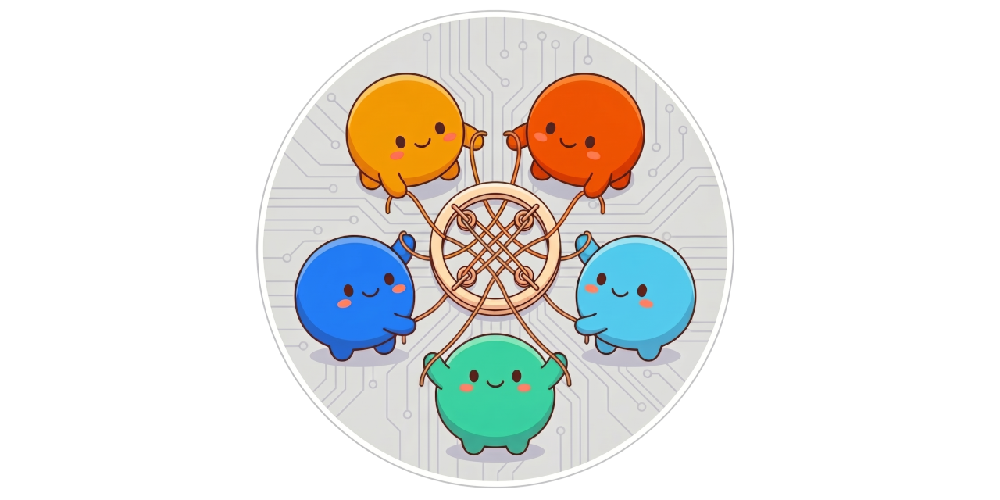
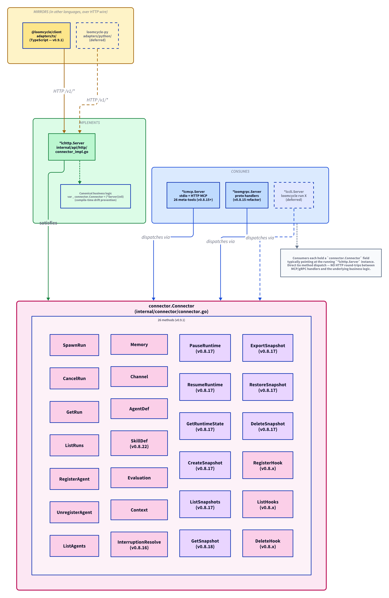

<p align="center">
  <a href="https://loomcycle.dev"></a>
</p>

<p align="center">
  <strong>An agent-system kernel you self-host.</strong><br/>
  <em>~80 MB Go binary that owns the agent loop and ships with memory, documents, teams, a Decision tool, a Crypto tool whose keys the model never sees, no-trace runs, ephemeral git-source volumes, a visual canvas, bundled dev toolchain and headless Chromium. A deployment-shape snapshot that carries the whole deployment in one archive. Multi-replica HA on Postgres. Apache-2.0 — v1.120.0.</em>
</p>

<p align="center">
  🌐 <a href="https://loomcycle.dev"><strong>loomcycle.dev</strong></a> &nbsp;·&nbsp;
  📝 <a href="https://loomcycle.dev/blog/">Engineering blog</a> &nbsp;·&nbsp;
  📐 <a href="https://github.com/denn-gubsky/loomcycle/blob/main/docs/ARCHITECTURE.md">Architecture</a>
</p>

<p align="center">
  <a href="https://github.com/denn-gubsky/loomcycle/releases"></a>
  <a href="LICENSE"></a>
  
  <a href="https://github.com/sponsors/denn-gubsky"></a>
</p>

---

> 🌳 **Stable and in production.** loomcycle is past v1.0 (currently v1.120) — feature-complete, hardened, and distribution-ready (Homebrew, multi-arch Docker, a Claude Code plugin, TS + Python adapters, a TrueNAS app). **Validated by two months of continuous production operation at JobEmber.ai** under real user load, with multi-replica HA on Postgres. Development since v1.0 has been new primitives plus hardening — see [`REVISIONS.md`](REVISIONS.md) for recent releases and [the releases page](https://github.com/denn-gubsky/loomcycle/releases) for the full history. Apache-2.0. We welcome bug reports, security disclosures, feature contributions, downstream consumers, and forks. See [`CONTRIBUTING.md`](CONTRIBUTING.md).

---

## What it is

**An agent-system kernel you self-host.** loomcycle is one Go binary, ~80 MB. It owns the agent loop and ships with everything an agent needs to be useful at scale: agentic memory with bi-temporal validity and subject-document identity, a document store with per-piece derived search units, per-scope SQL memory, a Decision tool for typed probability outputs, a Teams primitive for multi-agent state-machine workflows, a **Crypto tool** whose keys the model never sees (loomcycle-sealed or in Vault / AWS KMS / Google Cloud KMS), **no-trace runs** that deliver what they say and store none of it, **ephemeral git-source volumes** that fetch a repo so a forge token never enters a shell, three context-retention modes with a Recall tool over evicted spans, a tool-usage harness that lets small local models call tools at measured 10/10 success, a bundled development toolchain (Python, Go, Rust, Node, git, gh, curl, jq, sqlite3) and a headless Chromium, a visual canvas (LoomBoard) for building and debugging workflows, multi-replica HA on Postgres, OpenTelemetry, and a **deployment-shape snapshot** that carries the whole deployment in one archive.

**Integrates however your stack already works.** Your app calls loomcycle over HTTP, gRPC, MCP, the TypeScript adapter, or the Python adapter. The agent loop, multi-provider routing, memory and document subsystems, Decision tool, Teams, MCP server identity, OpenTelemetry traces, and multi-replica coordination all live in the binary. Your application stays in whatever language you wrote it in.

**What makes it different.** Most agent platforms are a library you embed, a hosted service you rent, or a gateway that does not run the loop. loomcycle is a self-hostable **agent-system kernel** that owns the loop *and* ships with the data substrate, teams primitive, decision model, Crypto tool, canvas, dev toolchain and headless browser already assembled.

## Last week delivered: v1.112 → v1.116 (Oct 13–19, 2026)

Five minor releases this week; longer writeups follow on [the blog](https://loomcycle.dev/blog/).

- **The Crypto tool (v1.116).** An agent names a key; the runtime encrypts, decrypts, signs, verifies, MACs, generates a TOTP or hashes — only the result comes back. Keys live in loomcycle (sealed under `LOOMCYCLE_SECRET_KEY`) or in **Vault Transit, AWS KMS or Google Cloud KMS** — in that case the key material never leaves the KMS. JWE, JWS, X25519, RSA-OAEP/PSS, Argon2id passwords, data by reference. Same ops on the operator API (`POST /v1/_crypto`, gRPC, MCP, TS and Python).
- **No-trace runs (v1.112).** A run that delivers what it says to its caller and stores none of it. Siblings: restricted tokens (lifetime, agent list, override lock, run-rate), strict budget enforcement on runs in flight, metered `llm:gateway`, one-call run-tree delete.
- **Git-in-the-core, ephemeral volumes (v1.113).** An agent can be given a repository the runtime fetched itself — an ephemeral read-only volume cloned from a `git` source. The forge token never enters a shell. Diff-size and inflated-pack-size bounded. Sibling features: forge webhooks (GitHub, Gitea, GitLab) that can start runs, signed hook deliveries, and the Microsoft Teams bridge.
- **Queued runs + call lanes + run-slot lending (v1.113 → v1.114).** A run that cannot start at once is **queued**, not refused: it gets its row, id and events before it waits, is cancellable, and survives a restart. A provider's `max_concurrent` now counts model calls in a **lane** per model kind. A run whose model call waits for a saturated local provider **lends its run slot** to a run bound elsewhere.
- **Bridges on a shared core (v1.113+).** The Microsoft Teams bridge refactored onto `@loomcycle/bridge-core`; three siblings followed — Telegram, Slack (every message inert by construction, no live mentions, every link's real target shown), and Discord over HTTP interactions.

See [`REVISIONS.md`](REVISIONS.md) for the per-release detail.

## What's shipped

Organised by what the runtime *does*, not by when each piece landed — for the
release-by-release view see [`REVISIONS.md`](REVISIONS.md) and the
[GitHub releases](https://github.com/denn-gubsky/loomcycle/releases).

| Capability | What you get |
|---|---|
| **Providers** | Anthropic, OpenAI, DeepSeek, Gemini, Ollama (cloud + local) over native HTTP with no vendor SDK, behind one `Provider` interface. Config-driven `providers:` map, per-tier/effort routing, user-tier fallback cascade, `PinAfterSuccess`, model aliases and `model_pattern` globs. Plus a synthetic **`code-js`** provider (deterministic, zero token cost) and a **mock** provider for load tests. Model aliases now carry **`kind: chat \| decision \| embedder`**; a wrong-slot wire fails config load with a named error. |
| **Built-in tools** | Read / Write / Edit / Grep / Glob / NotebookEdit / HTTP / WebFetch / WebSearch / Bash / Agent / Skill / Memory / Recall / Channel / History / Path / Document / AgentDef / SkillDef / TeamDef / **Decision** / **Crypto** (keys the model never sees: held by loomcycle or in Vault / AWS KMS / Google Cloud KMS) / Evaluation / Interruption / Context. |
| **Memory** | Four facets on one tool: key-value, **vector** (sqlite-vec / pgvector), **SQL** (a per-scope database, sqlite + postgres tiers), and the agentic **bi-temporal entity graph** with **subject-document identity** — the subject IS its own Document in the Path tree at `/entities/<type>/<name>`, placement is one decision, both halves of a fact land together. Rows carry `observed_at` (when a thing was said) and `valid_at`/`invalid_at` (when it was true), so an `as_of` query reads the timeline at any past instant and a correction never destroys the record. Every row carries a provenance envelope: tenant, session, run, agent, model, compaction generation, server-stamped `origin`, source-quote span. An optional `recall_attach_traces` runtime grant reattaches source turns to a facts recall — **LoCoMo paired-benchmark retrieval final 0.74**. |
| **Documents & paths** | Chunked-graph **Documents** (chunk bodies in Memory, structure in SQL Memory) with **per-piece derived search units** — a chunk with a heading, prose, code block and transclusion generates one embedding per piece, so a query for the code block does not compete with the heading for the same vector. **Documents retrieval final 0.966.** Inline `[[name]]` links become graph edges, `![[…]]` embeds transclude, plus backlinks / related / unlinked-mentions discovery, a per-chunk body-history with diff, queryable tags and type/status, images and Mermaid diagrams, and Markdown + JSON Canvas import/export — all addressed through a Unix-like **Path** VFS. |
| **Substrate** | Content-addressed (SHA-256), runtime-mutable, tenant-scoped defs pushed at boot: Agent / Skill / **Team** / MCPServer / Schedule / Webhook / MemoryBackend / A2A / Volume / Credential / OperatorToken / **HookDef**. Authored over every transport; verify-or-fork across deployments. |
| **Teams** | A multi-agent workflow is a state machine. A **TeamDef** carries its own **local agents, skills, channels, schedules, and webhooks** as one file, plus declared `variables` a start sets. Template-and-capture between states (`${steps.triage.answer}` interpolates a prior answer, `capture: {as: priority}` names a variable). Schedules and webhooks can start a Team directly. `TeamDef op=verify` returns `severity: refused \| unrunnable \| advisory` with JSON paths at fault, before saving. A visual **LoomBoard canvas** renders states as nodes with live run visualisation, drag-to-inject channel and variable nodes, and a Check button that calls verify without saving. |
| **Decision tool** | A model that cannot say the wrong word. Answers typed questions with calibrated probabilities over a fixed set of options; cannot write prose, cannot invent an answer that is not in the option set. Three question types: `choice` (2–26 options), `noul` (yes/no with probability of yes), `score` (ordered levels). 1–64 questions per call. Inside a run via Context grant; outside via `POST /v1/_decide`, gRPC `Decide`, MCP `decision`, `decide()` in TS and Python. Powers the memory reranker and the cascade verifier. |
| **Multi-agent** | Sub-agents via the `Agent` tool, `parallel_spawn` fan-out, external batch fan-out, resident/interactive sub-agents, a structured **state hand-off** from a stateful child to its parent, a state-machine **Team** orchestrator, and **poll-mode detached runs** — `Agent op=spawn` with `mode: "poll"` returns immediately with `{child_run_id, state: "running"}`; the parent collects later with `Agent op=poll`. Children survive pause, restart, replica move. `idempotency_key` for safe retries, `max_wall_seconds` for lifetime caps that apply to detached runs, `result: "object"` for structured child outcomes. |
| **Bundled tools** | The ~80 MB binary ships with the dev tools agents need (Python, Go, Rust, Node, git, gh, curl, jq, sqlite3) and a **headless Chromium** in-process. An agent that needs to compile, run tests, scrape a page, submit a form, or take a screenshot does not need an external sidecar, a separate toolbox image, or a Playwright install. Volumes default to **ephemeral per-run** — intermediate files are cleared when the run ends; durable mounts are opt-in via the operator's `volumes:` config. |
| **Isolation** | Per-agent ro/rw filesystem **Volumes** (sandbox-by-default, ephemeral-per-run default), an in-process **Bashbox**, and a **sandboxed code-execution** sidecar for untrusted multi-tenant workloads. |
| **Triggers** | Scheduler (no 10-minute cap, every replica can run slots, DB-claimed to avoid double-fire), inbound **Webhooks** (HMAC verify-before-parse), and **A2A** peer interop. |
| **Multi-tenancy** | Per-principal bearer tokens bound to an authoritative `(tenant, subject, scopes)`; per-route HTTP and per-RPC gRPC gates; tenant isolation across both the state and definition planes. Per-tenant credentials **plus per-user credential self-service** (every user manages its own `scope=user` API tokens from any transport), per-scope usage/cost attribution, token budgets, data-retention + subject-erasure surfaces, and a derived **directory** (who is here, what do we hold for them). Single-tenant stays the default. |
| **Context** | **Three retention modes**: `append` (baseline, every turn kept), `recap` (reasoning kept, log evicted), **stateful** (JSON-schema-validated state Σ carried forward, everything else evicted). A tier-routed `context.mode: auto` picks the mode from the resolved provider (schema-free recap on a local backend, structured stateful on a frontier API). An opt-in `context.recall` harvests each evicted span into a run-scoped embedded index and gives the agent a free-text **`Recall`** tool over it, falling back to durable memory. An opt-in `harvest_to_memory` bridges those spans into durable memory for future runs. Working range on a 200-turn chat: about one-fifth of baseline tokens at stateful on a task-shaped run. Plus context-transform plugins including a secret **redactor**, and `{{memory:…}}` / `{{tool:…}}` prompt expansion. |
| **Tool-usage harness** | Small local models call tools reliably. 159 per-operation help articles under `tools/<Tool>/<op>.md`; every failed tool-call error carries the operation's schema plus one worked example inlined into the error body; the stateful memo keeps the failing call and the help response together in the next turn's context. On a four-model benchmark against v1.100, both stateful models (cloud `deepseek-v4-flash` and local `ornith-1.5:35b`) hit **10 of 10 tasks**. |
| **Snapshots** | A snapshot now carries **the whole deployment**: users and budgets, schedules, webhooks, memory peers, document sources, volume mounts, the Path tree, and the consolidation queue. HMAC-signed secret references instead of literal secrets. Restore re-validates every definition against the current runtime version; a missing field or an unresolvable credential is flagged at a specific JSON path. One `loomcycle snapshot create` + `restore` moves a working deployment to a new VM. |
| **Operations** | Pause / Resume / Snapshot with cross-instance resume, multi-replica HA on Postgres LISTEN/NOTIFY (DB-backed session locks, singleton sweepers), OTEL + Prometheus, per-tenant fairness, tool-use hooks with widening audit, and **runtime config reload** (`POST /v1/_config/reload` — validate-before-apply, in-flight runs undisturbed). |
| **Interfaces** | HTTP+SSE, gRPC, loomcycle-as-an-MCP-server (`loomcycle mcp [--upstream]`), MCP client, the TS (`@loomcycle/client`) and Python adapters, an n8n package, an OpenAI-compatible LLM gateway, and an embedded React Web UI. Plus **LoomBoard** — a native desktop app (dmg/app/nsis/msi/appimage/deb) and a browser SPA that talks to the same runtime, with a visual teams canvas for building and debugging multi-agent workflows. |
| **Distribution** | Homebrew, multi-arch Docker, a Claude Code plugin, embedded config presets + agent bundles, and a TrueNAS SCALE app. |

## Two postures, one binary

Same Go binary, same config schema. Operator flips a few env vars to pick the posture.

| Posture | Configuration shape | Use case |
|---|---|---|
| **True managed sandbox** | `LOOMCYCLE_BASH_ENABLED=0`, no `volumes:` block (sandbox-by-default — agents get no disk access), `LOOMCYCLE_HTTP_HOST_ALLOWLIST` empty, `LOOMCYCLE_HTTP_CALLER_AUTHORITATIVE=1`. Every tool default-deny; agents can only reach what the caller's per-request `allowed_hosts` says. | Shared-server deployments processing untrusted prompts. The runtime survives contact with adversarial input. |
| **Agentic dev environment** | Bash enabled, a `default` rw `volumes:` entry pointing at your workspace, broad `allowed_hosts`, optional local Ollama for offline work. | Local development. Internal trusted operators. Single-user research workstation. |

The trust boundary is **operator / caller**. The operator config is the floor; callers can narrow per-request but never widen. The bearer token (`LOOMCYCLE_AUTH_TOKEN`) is the authority. Treat anyone with the token as fully trusted to drive the runtime. For true isolation in the sandbox posture, run loomcycle inside a container or VM. `Bash` is restricted (cwd, env scrub, output bounds, timeouts) but it is **not** a kernel-level sandbox.

## Install

Pick the path that fits. All four ship the same single static binary
plus the v0.11.1 `init` / `doctor` first-run flow. `Context.help
installation` covers each in detail.

```sh
# Homebrew (macOS + Linux)
brew install denn-gubsky/loomcycle/loomcycle

# Docker (v0.11.2+; pull works on amd64 + arm64 including Apple Silicon)
docker pull denngubsky/loomcycle:latest

# …or the same image from GHCR, if Docker Hub rate-limits your pulls.
# Byte-identical, published by the same release job. Docker Hub meters
# anonymous pulls per source IP — and for IPv6 per /64, so every host on
# one network shares a quota. Swap the prefix on any loomcycle image.
docker pull ghcr.io/denn-gubsky/loomcycle:latest

# go install from source (skips Web UI embedding — for dev only)
go install github.com/denn-gubsky/loomcycle/cmd/loomcycle@latest

# Direct tarball (one of darwin-arm64 / darwin-amd64 / linux-arm64 / linux-amd64)
curl -L https://github.com/denn-gubsky/loomcycle/releases/latest/download/loomcycle-darwin-arm64.tar.gz | tar xz
```

## Quick start (seconds, authenticated)

```sh
loomcycle init --with-token   # writes config + mints a token to ~/.config/loomcycle/auth.env (0600)
export ANTHROPIC_API_KEY=sk-...   # (or OPENAI_API_KEY / DEEPSEEK_API_KEY) — at least one provider key
loomcycle doctor              # verify env + keys + storage + the just-minted token
loomcycle                     # starts on 127.0.0.1:8787 (auto-loads auth.env — no shell-rc edit)
```

`init --with-token` prints the Web UI URL (`http://127.0.0.1:8787/ui`). Open it, then paste the token from `~/.config/loomcycle/auth.env` at the login prompt. (The token is kept in the `0600` file and never embedded in a URL. A `?token=` link would leak the bearer into browser history and into any fronting proxy's logs.) `loomcycle` and `loomcycle doctor` both auto-load `auth.env` from the config dir; a real `export LOOMCYCLE_AUTH_TOKEN=…` always overrides it.

## Bootstrap tiers

Pick the tier that fits. Each is a superset of the one above. **Auth is enforced only once something is configured**, so Tier 1 needs no token at all.

### Tier 1: zero-config dev (open mode, localhost)

No token, no flags. Fastest way to kick the tires on `127.0.0.1`.

```sh
loomcycle init               # config only — no secret written
export ANTHROPIC_API_KEY=sk-...
loomcycle                    # open mode: /v1/* + /ui pass through unauthenticated (logs a warning)
open http://127.0.0.1:8787/ui
```

With no `LOOMCYCLE_AUTH_TOKEN`, no config `principals:` and no minted tokens, the runtime runs **open** on localhost. Every request is allowed, whoami returns a synthetic admin. Good for a 10-second smoke test. **Never** expose this off localhost: the server refuses to start in open mode on a non-loopback address (`0.0.0.0`, `:8787`, a LAN IP) unless `LOOMCYCLE_ALLOW_OPEN_MODE=1` is set.

### Tier 2: single shared token (the recommended default)

One bearer gates everything. `init --with-token` is the easy button (above). Equivalent manual setup:

```sh
loomcycle init
export LOOMCYCLE_AUTH_TOKEN=$(openssl rand -hex 32)   # or: loomcycle init --with-token
export ANTHROPIC_API_KEY=sk-...
loomcycle
open "http://127.0.0.1:8787/ui?token=$LOOMCYCLE_AUTH_TOKEN"   # sets the cookie once
```

Treat anyone holding the token as fully trusted to drive the runtime.

### Tier 3: multi-tenant, per-principal tokens (RFC L, v0.17.0)

Mint a distinct bearer per developer / app, each bound to an authoritative `(tenant, subject, scopes)`. Migrate a Tier-2 deployment in place, no downtime:

```sh
# promote your existing shared token into the substrate, then mint scoped tokens
loomcycle operator-token create --copy-from-env --name ops --tenant ops --scopes substrate:admin
loomcycle operator-token create --name acme-app --tenant acme --subject alice --scopes runs:create
```

The first admin `OperatorTokenDef` disables the legacy shared-token fallback. Per-route HTTP and per-RPC gRPC scopes. The Web UI becomes role-aware (super-admin vs tenant). See `Context.help operator-tokens` and the v0.17.0 notes in [`REVISIONS.md`](REVISIONS.md).

**Smoke any tier:**

```sh
curl http://127.0.0.1:8787/healthz
# {"ok":true}
```

Real call (from another terminal):

```sh
curl -N http://127.0.0.1:8787/v1/runs \
  -H "Authorization: Bearer $LOOMCYCLE_AUTH_TOKEN" \
  -H "Content-Type: application/json" \
  -d '{"agent":"default","segments":[{"role":"user","content":[{"type":"trusted-text","text":"Hello"}]}]}'
```

Build from a checkout (for development):

```sh
make build-all       # UI + binary in one shot; output → ./bin/loomcycle
./bin/loomcycle --config loomcycle.example.yaml
```

**Multi-replica cluster demo (v0.12.x).** For a one-command `docker compose up` cluster (2 loomcycle replicas, Postgres, nginx LB) with a verify script, see [`examples/cluster/README.md`](examples/cluster/README.md). Full operator runbook in [`docs/MULTI-REPLICA.md`](docs/MULTI-REPLICA.md).

## Where it's going

Recent releases are in [`REVISIONS.md`](REVISIONS.md); the roadmap is
[`docs/PLAN.md`](docs/PLAN.md).

loomcycle is past its feature-complete milestone (v1.0.0) and the line since has
been primitives plus hardening: memory, documents, teams, sandboxing, retention
and erasure. The agentic-memory subsystem and the document surfaces built on it
remain the main direction.

The most recent line (v1.120.0) closes the security review whose fixes
shipped in v1.119.0. Boot no longer rewraps operator tokens minted before the
pepper: `loomcycle tokens rewrap` lists them and rewraps only the rows an
operator names after reviewing them. A deployment upgrading straight from a
release before v1.119.0 must run it once. A config reload keeps an admin
credential in config, a resume gives back exactly the per-user slot a run took,
and a batch spawn in join mode can no longer wait forever. Shared-tier
definitions are marked in get and list, and the chat bridges move to 0.2.0.
See the upgrade notes in [`REVISIONS.md`](REVISIONS.md).

Before it, v1.119.0 was the fixes from a security review of the
whole runtime. A server authenticated only by a minted admin token no longer
served a request unauthenticated when it could not read its token store. Open
mode was refused on a public listener, declaring config `principals:` turned
authentication on, and operator-token hashes were peppered whenever
`LOOMCYCLE_SECRET_KEY` is set. A shutdown
paused the runs in flight and a restart resumed them, `POST /v1/runs` started runs
the way every other transport does, logs could be JSON, and Amazon Bedrock could
be reached with AWS IAM credentials. See [`REVISIONS.md`](REVISIONS.md).

Before it, v1.118 was fixes. A queued run that never starts
now releases its idempotency key and publishes its end, and a restart during a
pause no longer holds the boot or a snapshot restore until the resume. An agent
told it hit the configured-run cap no longer retries forever, and only an
operator may change a shared HookDef. The v1.118.1 patch let a token be limited
to an agent named in a group, such as `chat/medium`, which every chat bridge
needs. See [`REVISIONS.md`](REVISIONS.md).

Before it, v1.117.0 upgraded gbash, the Bashbox sandbox, to
v0.0.40, so a script can no longer crash the loomcycle process: a deeply nested
jq value or a huge `dd` block size used to end every run on the replica, and
now fails as an ordinary command. Its symlink, size and time limits are
hardened too. Beside it shipped chat bridges for Slack, Telegram and Discord,
alongside Teams, on a shared `@loomcycle/bridge-core`, each published to npm on
its own version line. See [`REVISIONS.md`](REVISIONS.md).

Before it, v1.116.0 added a `Crypto` tool whose keys the model never
sees: an agent names a key and the runtime encrypts, decrypts, signs, verifies,
MACs or makes a one-time code, returning only the result. Keys are held by
loomcycle or in Vault Transit, AWS KMS or Google Cloud KMS, and the same
operations are on the operator API on every transport, with JWE public-key
encryption, RSA-PSS, Argon2id passwords, and data read from and written to a
volume, memory or a document by reference. Untrusted text now never reaches
memory, and another user who continues a session never gets the session user's
credentials. See "Crypto keys and the `Crypto` tool" in
[`docs/CREDENTIALS.md`](docs/CREDENTIALS.md).

Before it, v1.115.0 let an untrusted block carry code exactly as
written, in a fence the code cannot close, and is otherwise fixes from a code
review of the two lines before it: the run queue and provider lanes, and the
content-safety features. A no-trace child's answer is no longer stored in its
parent, a token limited to some agents can no longer control other agents'
runs, a trigger's run keeps away from its user's own credentials on every path,
and a YAML-declared MCP server that starts after loomcycle is picked up by the
next run under any tenant. See [`REVISIONS.md`](REVISIONS.md).

Before it, v1.114.0 was about sharing a busy local model host. Every
run, session message and gateway request waits in one fair run queue, and a run
whose model call waits for a busy provider lends its run slot to one bound
elsewhere. An agent or a single run can skip a busy provider for an idle
candidate of its tier, and a lane can hold a model that computes one request at a
time to one call. Forge webhooks can filter on the signed body, start one run
per event and carry a stored bearer. See "Per-provider concurrency" in
[`docs/PROVIDERS.md`](docs/PROVIDERS.md) and
[`docs/FORGE_WEBHOOKS.md`](docs/FORGE_WEBHOOKS.md).

Before it, v1.113.0 queued a run that cannot start at once instead of refusing
it, made a provider's `max_concurrent` count model calls in a lane per kind of
model, and let an agent read a repository the runtime fetched itself, so the
forge token never enters a shell.

Earlier, v1.112.0 was about handing a token to a machine you do not
control, and running agents on content you may not keep. A token can expire, be
limited to certain agents, be locked out of per-run settings and be rate
limited. A no-trace run (`retention: "none"`, set on a run, an agent or a
token) delivers what it says to its caller and stores none of it: the server
keeps a marker for each event and the error's class, never the text. A stored
run tree can be deleted, token budgets can be enforced on runs in flight, and
the raw model endpoints are now gated and metered. See "No-trace runs" and
"Multi-tenant authentication" in [`docs/CONFIGURATION.md`](docs/CONFIGURATION.md).

Earlier, v1.111.0 made the runs a team walk's member starts part
of the walk. A sub-agent, at any depth, carries its member's walk, state and
visit, so it is in the walk's listing and on the walk's stream; it is told from
a member by its parent run. Any run can also be asked for its children: a paged
listing by parent run, and the same filter on the run-state stream, on every
transport. See "Watching a team walk live" in
[`docs/CONFIGURATION.md`](docs/CONFIGURATION.md).

Earlier, v1.110.0 put a team decision's answer on the walk's own
run. A walk started detached returns no steps, and a `decision` state starts no
member run, so a client holding only the walk's run id could not read what a
decision answered. Each decision is one `team_decision` event on that run:
the state, the transition taken and the model's answer, read from the run's
event stream while the walk runs and after it has ended. See
[`docs/DECISION-MODELS.md`](docs/DECISION-MODELS.md).

Earlier, v1.109.0 let a team graph ask a decision model directly.
A state of kind `decision` asks typed questions, takes the transition the
answer selects and binds the answers to team variables, with no agent run; a
team that could never route on one of the answers is refused when it is saved.
Starting a team walk is also safe to retry: an `idempotency_key` on a team run
returns the walk already started.

Earlier, v1.108.1 was a patch with three provider fixes. A run on
a DeepSeek thinking model no longer fails on its first call after a context
compaction that happened in the middle of a turn. An agent with `effort: low`
or no effort set no longer gets a 400 from `gemini-3.5-flash-lite` or
`gemini-3.1-pro-preview`. A `model_pattern` alias that matches a model and a
suffixed variant of the same version now resolves to the base model.

Earlier, v1.108.0 let the person who runs a team see and release
what the team wrote to its own channels. A channel a team declares for itself
was readable only by the team's agents; three calls addressed by team and the
channel's local name now list those channels with their counts, peek at one
without consuming anything, and release what a held channel is holding. They
are on HTTP, gRPC and MCP and in both clients. Several guides that disagreed
with the code are corrected.

Earlier, v1.107.0 added decision models as a general capability:
an agent, a code body or an outside caller asks typed questions (pick one
option, yes or no, a position on a scale) and gets each answer with
probabilities instead of text. It is the `Decision` tool inside a run,
`POST /v1/_decide`, the gRPC `Decide` RPC and the MCP `decision` tool, with
`decide()` in both clients; calls made outside a run are metered to the caller.
A `models:` alias can say what kind of model it is (`kind: chat | decision |
embedder`), and an MCP session is now held to the scopes its token was granted.
See [`docs/DECISION-MODELS.md`](docs/DECISION-MODELS.md).

Earlier, v1.106.0 made starting a run safe to retry: a request
with an `idempotency_key` that a run already holds starts nothing and is
answered with that run. Any run can carry a lifetime limit of its own,
`max_wall_seconds`, a detached run included, and ends `cancelled` with stop
reason `wall_limit` when it runs out. A program that spawns a sub-agent can ask
for the child's outcome as an object, with its status, answer and token usage,
and a blocking spawn reports a run cancelled from outside as cancelled.

Earlier, v1.105.0 let an agent start sub-agents and team walks
in poll mode: the call returns at once, the parent keeps working, is told when
they finish and collects their results, and they survive a pause, a restart and
a move to another instance. A child can be bounded with `timeout_ms`, and one
that stops at its iteration limit reaches its caller as an error with its last
answer kept. Scheduled runs are no longer capped at 10 minutes, every replica
can run the scheduler, and a schedule sets what an overlapping slot does and
how many missed slots it makes up. A team can be checked before it is saved, a
cancel ends a run whose replica is gone, and a parent can hand a sub-agent
untrusted text as data.

Before it, v1.104.0 let a team definition carry its own agents,
skills, channels, schedules and webhooks, and declare variables a start sets,
so a workflow is handed over as one definition; a team's own webhook answers on
any instance, with durable dedup. Schedules and inbound webhooks can start a
team walk directly. An agent inside a run can no longer create an agent with
more authority than it holds, and retired webhook, skill, memory-backend and
A2A definitions are no longer served. Memory search can rerank with a decision
model, and the Web UI sets team variables and shows a team's own definitions.

Before it, v1.103.0 answered an operator message sent to a run
while it writes its final answer, where it used to be acknowledged and dropped;
a message sent after the run finished is refused. Team states can put the
previous state's output inside a template and capture a plain-text answer into
a variable, and a walk passes answers on without the sub-agent header. The Web
UI follows a document reference into another document with a breadcrumb back,
draws another tenant's team diagram for an admin, and has a reworked top bar. A
History result in a run never exceeds a quarter of the model's window.

Before it, v1.102.0 restored DeepSeek's cheapest model, which
DeepSeek renamed to `deepseek-flash` (every default config named the old,
now unlisted id, so it was skipped as a tier candidate), and made a run
whose model stream ends unfinished fail instead of completing empty. Model
speed measurement keys aliased models correctly, ignores Ollama's own
queue and takes a per-model cap. Team walks report the end state they reached
and appear on their own run-state stream, the Web UI starts a team from its
input form, and WebFetch no longer overflows a small model's window.

Before it, v1.101.2 was a patch. The Web UI's Path tree now loads
one directory at a time, so a user scope with a large `/facts` directory no
longer hides every directory that sorts after it. It also starts measuring each
model's speed (per-call timing on the usage ledger, a slowdown per model on
`/v1/_routing` and `/metrics`, with no timeout changed yet), and lets a team start
from its own input form, checked against the form before the walk runs.

Before it, v1.101.1 was a patch that fixed a v1.101.0 regression
in which a memory consolidation pass on a slow local model, cut by the new
per-pass budget, re-read the same chats forever: a cut pass now gets the whole
budget on its next turn, and the watermark advances after each chat. It also
stops a non-admin MCP server definition from reading the operator's env vars,
lets a remote memory peer key with its own tenant's `$cred:`, and adds a
team-walk view to the Web UI, with each walk recording the team version it ran.

Before it, v1.101.0 made a snapshot carry the whole deployment:
users and budgets, schedules, webhooks, peers, memory backends, volumes, the
Path tree and the consolidation queue. Literal trigger credentials are
stripped, and every definition is re-checked against the target's own rules. A
paused run now resumes as the run that paused: on the agent version it started
on, in its own tenant, and no wider than its parent allowed. A security review
closed cross-tenant and isolated-member gaps in webhooks, triggers, remote
peers, the private-address guard and volume paths. Team walks gained review on
agent and parallel states, an enforced `timeout_ms`, and fan-out over a
document's sections.

Before it, v1.100.0 let an operator give documents derived search
units, short texts about each chunk that a question can match, generated by an
explicit pass and never returned in place of the chunk. It made a stateful run
keep what Context returned across its steps, kept a paused run on the hooks it
started with, and refused a cut document id or a malformed path instead of
letting a model create a second document.

Before it, v1.99.0 let a channel carry hooks that decide every
message before a reader sees it (release, rewrite, drop, or hold for a person
to answer), and split global channels by tenant over a shared operator layer.
It indexed each document chunk under its document and section, made Document
search match words as well as meaning, and added an opt-in rerank. It also let
a DeepSeek thinking model run in stateful mode, and gave a malformed call the
help its run skipped.

Before it, v1.98.0 made a failed tool call tell the model what
kind of failure it was (fix the input, it will never work, or try again later)
together with the correct call format, on every interface. It let a run request,
a parent run and a TeamDef add hooks, and the Web UI now edits them. It also
closed three existence oracles and a webhook relay that delivered past a
tenant's held channel, and fixed consolidator fact writes that had been refused
since v1.95.0.

Before it, v1.97.0 moved hooks onto the run: an agent's
definition carries its hooks, with credentials allowed in webhook headers, and
the runtime hook registration API is removed (a breaking change). It also
stopped the dead-link sweeper deleting live chunk text in scopes past 10,000
chunks, let the chat agents write notes and documents the whole tenant reads,
and made Context say in the tool list that it holds every tool's call
instructions.

Before it, v1.96.0 made hooks reusable, versioned definitions
(HookDef, on every transport and in snapshots), kept a stateful answer a local
model wrote as prose instead of failing the run on it, and stopped a run that
kept re-sending the same failed call instead of letting it spin to its
deadline.

Before it, v1.95.0 closed two isolation gaps — an isolated member
could read another user's run content and answer its questions — added the
subagent, compaction and run_end hook phases, and fixed what measuring local
models turned up: a stateful run now keeps its task on every step, an unknown
tool argument is refused with the correct call instead of silently dropped, and
the prompt's tool list says to read a tool's call format first.

Before it, v1.94.0 let a team walk hold its members for review
(`"<starter>:review"`, replacing the removed `after_collection` pause, ⚠️ breaking)
and started hooks v2: every decision is recorded as a `hook_decision` event,
`agent_start` / `agent_stop` hooks can deny a run or block or hold its answer, and a
hook can be in-process JavaScript that asks an operator. A tool's help is now an
instruction to read it first, and a failed call carries a correct example.

Before it, v1.93.0 carried on making the Run the unit a caller
configures: a run can answer to a JSON schema (`output_format`, parsed into
`result.structured`), be saved as a draft and started later (`"start": false`,
then `POST /v1/runs/{run_id}/start`, with a Web UI "Save as draft"), keep its
spec readable after it ends, and be held for an operator's approve / reject
before it counts (`review: true`), a hold that survives a pause or restart and
expires as rejected. Every tool now names the `Context` call that returns its
help article, and the scopes the run may use. The per-operation articles
behind that, written from the code, corrected a dozen tool descriptions and
found four bugs, among them a refused Memory write that was stored anyway and
an Agent schema that Claude and Gemini saw as spawn-only.

Before it, v1.92.0 made the Run the unit a caller reads and steers:
a run keeps its final answer and the exact prompt its first model call was sent
(`GET /v1/runs/{run_id}/prompt`), and an agent or a single run can say which
tool the model must call and for how long (`tool_choice` with `until`). It also
closed two security gaps — a tenant hook could reach private addresses, and MCP
`get_run` could read another tenant's runs — stopped current Anthropic models
rejecting the request shape (which broke every stateful run on them), and made a
stateful step that only plans its next move go back to the model instead of
being shown as the answer.

Before it, v1.91.0 fixed a local model's answers going missing in
that mode: it wrote its reply INTO the state (`{"patch":{"final":…}}`) rather
than beside it, so the operator saw an empty turn while the answer sat in Σ. The
loop now moves the reply fields out of the patch and deletes them from the state.

Before it, v1.90.0 made an interactive structured-state chat keep
its state. v1.88.0 gave the stateful loop a park, but it emitted `done` after every
answer, so the embedded terminal marked the chat completed and sent the next
message as a new run — one that started from an empty state with the whole
transcript as its input, while the parked run leaked. It now stays live, resume
and continuation start from the recorded state, and the loop gets what every
other run gets: heartbeat, tool-use hooks, the `redact` plugin, retry and
fallback, and runtime pause.

Before it, v1.89.0 closed a token-budget bypass: the structured-state
loop never emitted a per-call usage event, so a `mode: stateful` run wrote no
ledger rows, reported no cost, and — the part that matters — incremented no
per-scope budget counter. An operator who had set a hard token limit was not
protected from that mode. It reports its spend now.

Before it, v1.88.0 made the structured-state context mode usable
from a terminal. An agent on `context.mode: stateful` ended its run after every
answer whatever `interactive` said — the loop had no park and no steering at all
— and a resumed one started from an empty state, continuing a conversation whose
every established fact it had forgotten. It now parks for the operator's next
message, takes that message as its next observation, and recovers its state from
the transcript after a pause, snapshot restore or replica move.

Before it, v1.87.0 closed a privilege-escalation defect and three
failures an operator found in one afternoon. ⚠️ Minting an operator token with
no `scopes` used to default to `substrate:admin`, so a mistyped key — sending
`allowed_scopes`, which is what the response echoes — silently handed out a
full-power token, and one of those also disables the legacy
`LOOMCYCLE_AUTH_TOKEN` login, locking the deployment out of its own API. An
omitted list is now refused and the mint tool rejects unknown keys. Alongside
it: the stateful loop re-prompts a model that answered in prose instead of
killing the run, `tool_choice` reaches every driver that has one (Ollama has
none, and degrades rather than refusing), a summarizer is no longer capped at
192 output tokens it spends thinking, and `context.model` can point recap at a
cheap non-thinking model.

⚠️ **Breaking:** `loomcycle operator-token create` now requires `--scopes`.

Before it, v1.86.0 fixed the regression v1.85.0 shipped with, found
in production within a day. The distillation gate's footprint is seeded before
the first call so a one-iteration continuation can still distil — but that seed
counts the system prompt and tool catalogue, which distillation cannot shrink,
so on a preamble-heavy agent it crossed the threshold on iteration zero and the
run alarmed three times about a request it had not sent. The gate still opens on
the seed; only the operator-facing reports now wait for a footprint a provider
returned. The same release makes every wire event value nameable from
`@loomcycle/client` — sixteen were missing from its `EventType`, including the
one the incident turned on — and fixes an effective-config report that computed
its `inert` advisory against the stored definition while answering `fields` from
the run.

Before it, v1.85.0 made distillation RECOVERABLE. v1.84.0 made a
failed distillation visible; this one closes the gap that visibility exposed — a
recap that declined had no second tier, `stateful` had no bound at all in the
dimension that actually grows (its state object Σ), and a pinning `keep_last_n`
could veto every path. Compaction is now reachable from every mode, Σ is evicted
by declared retention class, the window beats `keep_last_n`, and a run that
cannot reclaim says so rather than climbing to the provider's limit. It also
fixes a v1.84.0 defect found in production: the footprint counted the
conversation but not the system prompt or tool catalogue, so a small-window agent
sent 163% of its window with the gate never opening.

And before that, v1.84.0 made context distillation impossible to fail
silently. A live chat had climbed to the top of its window while auto-distillation
never fired once — threshold crossed at 72%, next call at 99%, zero markers and
zero errors — because a decline could take any of five paths and emit nothing. A
`context_distill_declined` event now names which one and what to change, a
distillation whose result is not smaller is refused rather than applied, a run
that answers in a single iteration can still distil, a manual compact operates on
the session the loop actually holds, and configuration that cannot take effect
says so at boot. The same release closes three grpc vulnerabilities on the serving
path, two of them unauthenticated remote DoS.

Before it, v1.83.0 gave the run controls their READS. v1.82.0 let a
run carry its own model, budgets and tuning, and all of it was write-only: a
caller could set an override and had no way to read it back. A run's
configuration can now be read, and separately its EFFECTIVE configuration —
field by field, with the layer that decided each, because `max_iterations: 16`
cannot distinguish a deliberate setting from a default nobody chose. Retune
reaches all five surfaces, and a running agent can be promoted to interactive,
so a long autonomous run that needs a correction no longer has to be cancelled
and restarted.

The same release finished the capability-gate work: a tool an agent was GRANTED
but could never use now says so at run start, on the run's own event channel,
carrying the yaml key that fixes it. `sql_scopes` and `evaluation_scopes` joined
`memory_scopes` / `history_scope` in resolving to what the caller already owns —
a posture change on upgrade; see [`REVISIONS.md`](REVISIONS.md).

Before it, v1.80.0 made a tool failure legible to the agent receiving it. A
failed call used to arrive as one boolean and one English sentence, so "no rows
matched" and "the database was unreachable" were the same shape — and they call
for opposite next moves. A failure now carries its category, whether resending
can succeed, what to do instead, and a backoff where waiting actually helps, on
every surface an agent can reach.

## Architecture

Three diagrams cover different views of the same runtime:

<p align="center">
  
</p>

Diagram source: [`docs/architecture.d2`](docs/architecture.d2) (regenerate with `d2 docs/architecture.d2 docs/assets/architecture.png`).

**Connector detail.** The v0.8.15 `Connector` abstraction layer (the pink block in the middle of the main diagram) is the architectural anchor every wire transport dispatches through. The detail diagram enumerates the interface and shows which transports IMPLEMENT, CONSUME, and MIRROR it:

<p align="center">
  
</p>

Source: [`docs/architecture-connector.d2`](docs/architecture-connector.d2).

> **Diagram vintage.** Both renders are a snapshot — the connector view is labelled
> v0.17.x and the MCP block v0.21.0 — and the runtime has grown past them. As of
> v1.80.0 the interface carries **65 methods** and the MCP server exposes **52
> meta-tools**. The shapes and the relationships they show are still accurate; only
> the counts have moved. Regenerating needs `d2` with its Chromium renderer.

**Multi-replica cluster mode (v0.12.x).** When `LOOMCYCLE_REPLICA_ID` is set per process and the Postgres backend is used, loomcycle runs as a cluster behind any HTTP load balancer. The shared Postgres doubles as the LISTEN / NOTIFY backplane for cross-replica cancel, pause / resume, run-state fanout, and quota notifications. SQLite refuses cluster mode at boot.

<p align="center">
  
</p>

Source: [`docs/architecture-cluster.d2`](docs/architecture-cluster.d2). Operator runbook: [`docs/MULTI-REPLICA.md`](docs/MULTI-REPLICA.md). Demo: [`examples/cluster/README.md`](examples/cluster/README.md).

Full request flow, abstractions, and concurrency model: [`docs/ARCHITECTURE.md`](docs/ARCHITECTURE.md).

## Adapters

- **TypeScript.** `npm install @loomcycle/client` (see [`adapters/ts/`](adapters/ts/)). HTTP + SSE.
- **Python.** `pip install loomcycle` (see [`adapters/python/`](adapters/python/)). Async over `grpc.aio`.

## Security highlights

- **No vendor binary** in the loop. Pure HTTP to provider APIs. No subprocess auth inheritance.
- **Default-deny everything.** Every built-in tool is disabled until env-configured. Every agent gets zero tools until `tools` is set.
- **Two-layer policy + per-request narrowing.** Operator floor in env; agent narrowing in yaml; caller narrowing per-run. Caller can never widen.
- **SSRF defence.** Hostname allowlist + RFC1918/loopback/link-local IP block at the dial layer, re-checked on the connected address, so DNS rebinding cannot slip past it. A private host the operator vouches for **by name** may still resolve to any private address except link-local and cloud metadata; vouch by CIDR to trust no name. See [`docs/TOOLS.md`](docs/TOOLS.md).
- **Constant-time bearer auth.** `sha256+CTC` on both HTTP and gRPC.
- **`Bash` is restricted, not isolated.** Run inside a container or VM if you need real isolation.

Full security model and the two-layer default-deny walkthrough: [`docs/TOOLS.md`](docs/TOOLS.md). To report a vulnerability, see [`SECURITY.md`](SECURITY.md).

## Documentation

Repo-side docs (this directory):

- [`docs/ARCHITECTURE.md`](docs/ARCHITECTURE.md). Request flow, provider abstraction, agent loop, sub-agents, skills, storage, concurrency, cancellation.
- [`docs/TOOLS.md`](docs/TOOLS.md). Two-layer default-deny model, every built-in tool, MCP / LocalAPI integrations, per-request narrowing.
- [`docs/DECISION-MODELS.md`](docs/DECISION-MODELS.md). Decision models: models that answer typed questions (pick one, yes/no, a score) about a piece of state with probabilities instead of prose — the `kind` tag and the `decision:` block, the request and answer formats, the four surfaces (the `Decision` tool, `POST /v1/_decide`, gRPC `Decide`, the MCP `decision` tool), and who pays.
- [`docs/MEMORY-ARCHITECTURE.md`](docs/MEMORY-ARCHITECTURE.md). How memory actually works: the four kinds (chats, the pending queue, distilled facts, in-run context), a structure diagram and two state diagrams (a fact's lifecycle, the consolidator's pass), scopes and the per-scope Postgres isolation, the ontology and placement — plus **what has been measured**, the known limitations, and what is left to do.
- [`docs/CUSTOMIZING_AGENTS.md`](docs/CUSTOMIZING_AGENTS.md). Adding a skill, tool, or whole MCP server to a chat agent: the capability model (who may widen a tool ceiling and why), when a skill is free vs when you must derive a new agent, `mcp__<server>__*` grants, in-place widening of dynamic agents, and delegation.
- [`docs/PATH.md`](docs/PATH.md). The Path primitive (RFC AL): a Unix-like VFS over Memory / Volumes / Documents — the dirent model, the six ops, and the off-run cross-transport surface (HTTP / gRPC / MCP / TS / Python).
- [`docs/DOCUMENTS.md`](docs/DOCUMENTS.md). The Document primitive (RFC AK): chunked-graph documents — content/structure split, the 13 ops, optimistic concurrency, atomic deletes, and the off-run cross-transport surface.
- [`docs/MCP_INTEGRATION.md`](docs/MCP_INTEGRATION.md). End-to-end MCP HTTP pipeline: request lifecycle, `${run.user_bearer}` substitution, model-visibility boundary, recipe for wrapping a REST API as an MCP server consumable by loomcycle.
- [`docs/MCP_SERVER.md`](docs/MCP_SERVER.md). Register loomcycle as an MCP server in Claude Code / Claude Desktop. Copy-paste config snippets for Docker / Homebrew / direct-binary transports, plus the `loomcycle mcp install` helper.
- [`docs/CLAUDE-CODE.md`](docs/CLAUDE-CODE.md). Driving loomcycle from Claude Code: the recommended `claude-code-plugin-loomcycle` plugin (slash commands + skills + hooks) vs. the manual `loomcycle mcp install` path.
- [`docs/CONFIGURATION.md`](docs/CONFIGURATION.md). Operator config guide: provider / tier / user_tier resolution rules, four cookbook patterns (single / multi-provider × single / multi-user-tier), `models:` alias map, and the agent `.md` frontmatter field reference.
- [`docs/SEARCH.md`](docs/SEARCH.md). Web-search providers (RFC BB): the catalog + fallback circuit, `search_providers` / `search_priority` config, per-agent lists, operator/tenant keys, the routing view — and a self-hosted **SearXNG** deploy recipe (the sidecar + the three `settings.yml` knobs + verification).
- [`docs/POSTGRES.md`](docs/POSTGRES.md). Postgres backend operator guide: configuration, migrations, sqlite → postgres runbook, concurrency benchmark.
- [`docs/GRPC.md`](docs/GRPC.md). gRPC surface: enablement, wire-shape parity with HTTP + SSE, error mapping, Python adapter quick-start.
- [`docs/PLAN.md`](docs/PLAN.md). Public roadmap and current direction.
- [`REVISIONS.md`](REVISIONS.md). Release notes for the most recent versions; older ones are on the [releases page](https://github.com/denn-gubsky/loomcycle/releases).
- [`CONTRIBUTING.md`](CONTRIBUTING.md). Contribution policy (closed for external PRs until v1.x).
- [`CLAUDE.md`](CLAUDE.md). Project guide for agents working in this repo (Claude Code).

In-binary docs (bundled `Context.help` topics; agents read these directly, operators hit `GET /v1/_help/<topic>` against a running instance):

- `installation`. All four install paths (Homebrew, Docker, `go install`, direct tarball) with verification + troubleshooting.
- `getting-started`. First-run walkthrough: `init` → set env vars → `doctor` → run.
- `llm-gateway`. Direct LLM routing endpoint (v0.11.0; for n8n + LangChain consumers).
- `openai-compat`. Drop-in OpenAI SDK shims (v0.11.3 chat + v0.11.4 embeddings) with Python + TypeScript examples.
- `fairness`. Per-user concurrency quota policy.
- `observability`. OTEL trace export setup.
- `vector-memory`, `voyage-embedder`, `sqlite-vec`. Vector Memory backends.
- `dynamic-mcp`. Register MCP servers at runtime.
- `bashbox`. The in-process Bashbox sandbox, and how it differs from the restricted-not-isolated Bash tool.

Full list via `GET /v1/_help` against a running instance.

## Sponsor

If loomcycle is useful to you or your team, [GitHub Sponsors](https://github.com/sponsors/denn-gubsky) helps fund continued development. Individual supporters and corporate sponsors both welcome.

The runtime stays Apache-2.0 either way. Sponsorships fund the v1.x runway: Helm chart, operator cookbook, settings UI, and the sustained engineering that keeps the binary small and the substrate stable.

Current sponsors are listed in [`BACKERS.md`](BACKERS.md) (and at [loomcycle.dev/sponsors](https://loomcycle.dev/sponsors) with logos).

## License

Apache-2.0. See [LICENSE](LICENSE).
