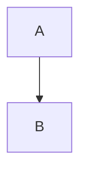

# Протокол засідання — Board minutes

**Draft** · From minutes.docx (SharePoint) · 2026-11-16

- [Порядок денний](#chunk-s1)
- [Рішення](#chunk-s2)
  - [Деталі](#chunk-s21)

Вступ: *курсив*, **жирний**, ~~закреслений~~ and `code span`. A soft break, and a hard\
break.

<a id="chunk-s1"></a>

## Порядок денний

1. Перше питання
2. Друге питання

   - вкладений пункт
   - ще один

- \[x\] done
- \[ \] open

> Цитата з **виділенням**.

| Name | Votes | Note |
| :--- | ---: | :---: |
| Іван | 3 | a \| pipe |
| Ann | 10 | ok |

See [section two](<#chunk-s2>), [the site](<https://example.com/a?b=1&c=2>), and [mail](<mailto:board@example.com>).

---

```go
func main() { fmt.Println("<b>") }
```

<a id="chunk-s2"></a>

## Рішення

![Схема \[1\]](<fixture/img-1.png>)



#### Підрозділ у тексті

Текст.

<a id="chunk-s21"></a>

### Деталі

Last paragraph.

